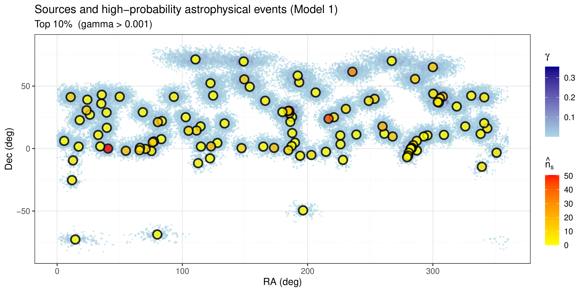

# IceCube Neutrino Clustering and Source Modeling

[Report (PDF)](report.pdf) · [Project page](https://gabripaganelli.github.io/projects/icecube.html)


*Sky map: top 10% events by astrophysical posterior probability (Model 1) and the 110 candidate sources*

## Overview

University project applying Bayesian inference to the classification of ~880,000
IceCube muon-neutrino events from the IC86 seasons (2011–2018) of the 10-year
point-source sample (2008–2018)
as **astrophysical** vs. **atmospheric** in origin. Three Stan models are compared,
combining truncated power-law energy spectra with Gaussian spatial proximity
weights relative to 110 known source candidates.

Pre-computed fits and intermediate outputs are included in `output/`.
To reproduce figures and posteriors from cached results (~5 minutes):

```r
source("R/05_posteriors.R")   # spatial-energy combination
source("R/06_plots.R")        # all figures → output/figures/
```

---

## Methodology

Three competing Bayesian models are fitted via MCMC (Stan):

| Model | Stan file | Priors | Spatial treatment |
|---|---|---|---|
| M1 | `stan/model_spatial.stan` | Informed | Spatial weights embedded in Stan likelihood |
| M2 | `stan/model_informed.stan` | Informed | Post-hoc Bayesian odds update (`05_posteriors.R`) |
| M3 | `stan/model_uniform.stan` | Uniform | Post-hoc Bayesian odds update (`05_posteriors.R`) |

Spatial weight for event *i*:

$$w_i = \frac{1}{\bar{w_j}} \sum_{j=1}^{110} \exp \left(-\frac{\theta_{ij}^2}{2 \sigma_{\text{eff},j}^2}\right)$$

where $\sigma_{\text{eff}}^2 = \sigma_{\text{meas}}^2 + \sigma_{\text{src}}^2$.

Energy spectra follow a truncated power law; the spectral index γ is the
primary parameter of interest, estimated separately for astrophysical and
atmospheric populations.

---

## Repository Structure

```
icecube-neutrino-bayes/
├── README.md
├── LICENSE
├── CITATION.cff
├── report.pdf
├── figures/                  # Sky map image (README)
│
├── data/
│   ├── raw/                  # IC86 I–VII event CSV files (~91 MB total)
│   ├── sources.txt           # 110-source catalogue
│   └── data_readme.txt       # IceCube data format documentation
│
├── stan/
│   ├── model_spatial.stan    # Model 1
│   ├── model_informed.stan   # Model 2
│   └── model_uniform.stan    # Model 3
│
├── R/
│   ├── 01_import.R           # Load raw CSV data
│   ├── 02_preprocess.R       # Clean + EDA + spatial weights
│   ├── 03_fit_model1.R       # MCMC fit — Model 1  [~8h]
│   ├── 04_fit_models23.R     # MCMC fit — Models 2 & 3  [~7h each]
│   ├── 05_posteriors.R       # Stage 2 spatial combination
│   └── 06_plots.R            # All figures
│
└── output/
    ├── figures/                 # Generated PDFs
    ├── data.rds                 # Cleaned events + spatial weights
    ├── sources.rds              # Source catalogue
    ├── icecube_all.rds          # Raw combined events
    ├── fit_model1/2/3.rds       # Stan fit objects (~2 MB each)
    ├── gamma_model1/2/3.rds     # Energy-only posteriors
    └── gamma_star_model2/3.rds  # Final combined posteriors
```

---

## Installation

R ≥ 4.1 and RStan ≥ 2.21.

```r
install.packages(c("rstan", "tidyverse", "bayesplot", "ggplot2",
                   "gridExtra", "posterior", "patchwork", "ggnewscale"))
```

Tested on:

```
R version 4.4.1 (2024-06-14 ucrt)
Platform: x86_64-w64-mingw32/x64 — Windows 11 x64 (build 26200)

rstan_2.32.7        StanHeaders_2.32.10   bayesplot_1.15.0
posterior_1.6.1     ggplot2_4.0.2         patchwork_1.3.2
ggnewscale_0.5.2    gridExtra_2.3
```

---

## Usage

### Quick start (from cached fits, ~5 minutes)

```r
source("R/05_posteriors.R")   # spatial-energy combination
source("R/06_plots.R")        # all figures → output/figures/
```

### Full reproduction (~22 hours)

```r
source("R/01_import.R")        # load raw CSVs          → output/icecube_all.rds
source("R/02_preprocess.R")    # clean + spatial weights → output/data.rds

# Steps 3 and 4 are independent and can be run in separate R sessions:
source("R/03_fit_model1.R")    # ~8h       — Model 1
source("R/04_fit_models23.R")  # ~7h each  — Models 2 & 3

source("R/05_posteriors.R")    # spatial combination for Models 2 & 3
source("R/06_plots.R")         # all figures
```

Run all scripts from the repository root.

---

## Results

**Main results** (from the report's conclusions):
- Spectral degeneracy: the astrophysical and atmospheric power-law indices collapse to nearly identical values (≈ 1.12 in Models 2–3; 1.22 vs 1.12 in Model 1), so energy does not discriminate between the two classes
- Event-level classification is therefore driven almost entirely by angular proximity to the 110 candidate sources
- With energy uninformative, the astrophysical fraction π_astro is not identified and follows the prior: 0.00247 (M1), 0.0417 (M2), 0.3732 (M3)

| Figure | Content |
|---|---|
| `output/figures/map.pdf` | Sky map: top-10% events (Model 1) overlaid on source positions |
| `output/figures/diagnostics.pdf` | MCMC trace, density, ACF for all three models |
| `output/figures/posteriors.pdf` | Parameter comparison + prior/posterior overlay |
| `output/figures/ppc_model1.pdf` | Posterior predictive checks (Model 1) |
| `output/figures/gamma_comparison.pdf` | Final γ* distributions across all models |

**Data reference:** IceCube Collaboration, *Time-integrated Neutrino Source Searches
with 10 years of IceCube Data*, Phys. Rev. Lett. **124**, 051103 (2020).
[DOI: 10.1103/PhysRevLett.124.051103](https://doi.org/10.1103/PhysRevLett.124.051103) · [arXiv:1910.08488](https://arxiv.org/abs/1910.08488)

**Data:** IceCube public data release *All-sky point-source IceCube data: years 2008–2018*
([DOI: 10.21234/sxvs-mt83](https://doi.org/10.21234/sxvs-mt83)), CC0 1.0.
`data/sources.txt` reproduces Table III of the paper. The MIT license covers the code only.

---

## Author

**Gabriele Paganelli** — University of Padova / Boston University
